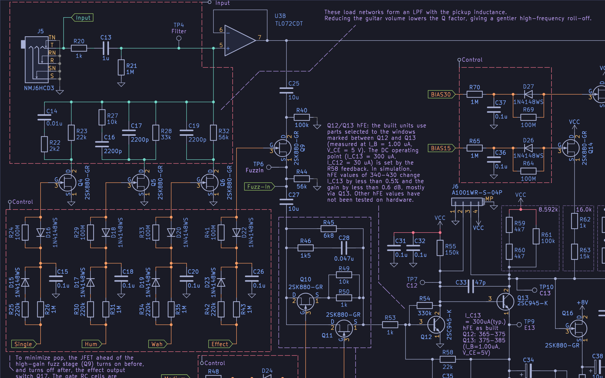
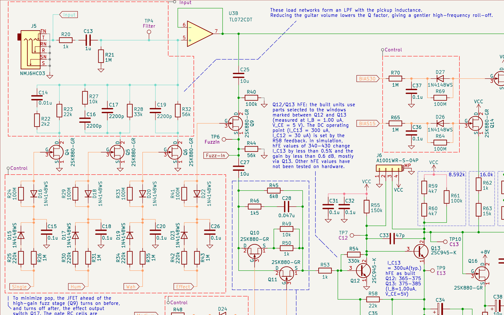
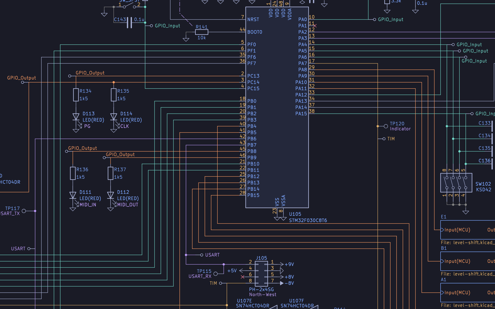

# Tokyo Night (Schematic)

A dark KiCad color theme for the schematic editor, built on the [Tokyo Night](https://github.com/enkia/tokyo-night-vscode-theme) palette (night variant, background `#1a1b26`).

**Scope:** the theme covers the schematic editor only. The PCB editor, 3D viewer and GerbView sections keep near-default KiCad colors. Each editor in KiCad picks its theme on its own, so you can pair this with any PCB theme.

## Screenshots

Tokyo Night (Schematic):

KiCad default, same sheet and framing:

The sheet is the top board of [Anthracite](https://github.com/trope-oshw/anthracite), exported with `kicad-cli sch export svg --theme`. The orange, teal and red wires in both images come from net class colors in that project, and KiCad draws them over the theme's wire color. See [Net class colors](#net-class-colors) for the palette.

## Net class colors

KiCad stores net class wire colors in the project file (`.kicad_pro`), and this theme does not set them. For wires that match the theme, pick from the Tokyo Night palette below. The names follow [tokyonight.nvim](https://github.com/folke/tokyonight.nvim).

| Swatch | Color | Hex |
| --- | --- | --- |
|  | red | `#f7768e` |
|  | orange | `#ff9e64` |
|  | yellow | `#e0af68` |
|  | green | `#9ece6a` |
|  | green1 | `#73daca` |
|  | cyan | `#7dcfff` |
|  | blue | `#7aa2f7` |
|  | magenta | `#bb9af7` |
|  | dark5 | `#737aa2` |

To apply a color, open **File > Schematic Setup > Project > Net Classes** and set the **Color** column for the class.

The Anthracite bottom board uses several of these colors for its net classes:

## Install

### Plugin and Content Manager

1. Download `kicad-tokyo-night-schematic-1.0.0.zip` from the [latest release](https://github.com/Mjm-12/kicad-tokyo-night-schematic/releases/latest).
2. In KiCad, open the Plugin and Content Manager and click **Install from File...**.
3. Select the zip.

### Manual

Copy `colors/tokyo-night-schematic.json` into the KiCad colors folder for your OS:

| OS | Folder |
| --- | --- |
| Windows | `%APPDATA%\kicad\10.0\colors\` |
| macOS | `~/Library/Preferences/kicad/10.0/colors/` |
| Linux | `~/.config/kicad/10.0/colors/` |

If KiCad is running, restart it.

### Select the theme

Open **Preferences > Schematic Editor > Colors** and choose **Tokyo Night (Schematic)**.

## Compatibility

Tested on KiCad 10.0.1. The theme file uses the KiCad 10 color settings format (`meta.version` 5).

## Credits

Colors come from the Tokyo Night theme by enkia: <https://github.com/enkia/tokyo-night-vscode-theme> (MIT).

## License

MIT. See [LICENSE](LICENSE).
